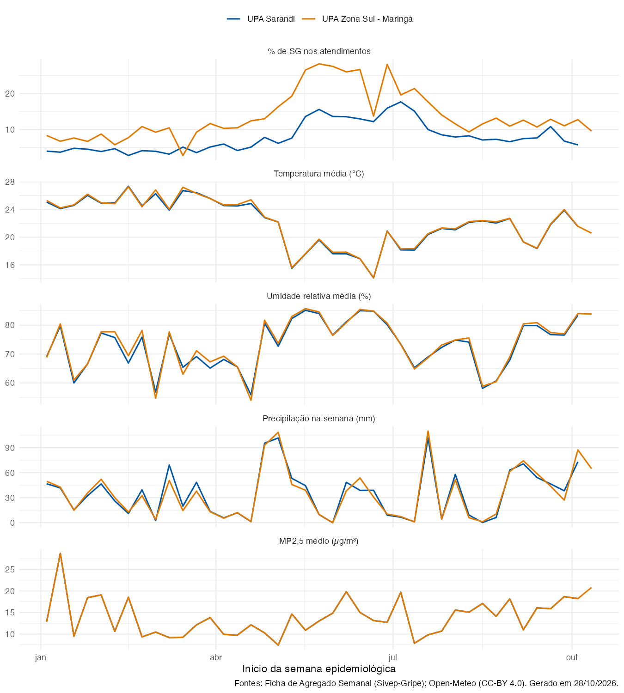



```{r}
#| label: setup
library(dplyr)
library(tidyr)
library(readr)
library(gt)

ler_dado <- function(arquivo) {
  caminho <- file.path("dados", arquivo)
  if (!file.exists(caminho)) return(NULL)
  readr::read_csv2(caminho, show_col_types = FALSE)
}

casos_clima <- ler_dado("casos_clima_semanal.csv")
correlacao  <- ler_dado("correlacao_casos_clima.csv")

# Nomes legíveis das variáveis (os mesmos usados no script_clima_casos.R).
rotulos_variaveis <- c(
  temp_media      = "Temperatura média (°C)",
  temp_min        = "Temperatura mínima da semana (°C)",
  temp_max        = "Temperatura máxima da semana (°C)",
  amplitude_media = "Amplitude térmica média (°C)",
  umidade_media   = "Umidade relativa média (%)",
  umidade_min     = "Umidade relativa mínima (%)",
  precipitacao_mm = "Precipitação na semana (mm)",
  pm2_5           = "MP2,5 médio (µg/m³)",
  pm10            = "MP10 médio (µg/m³)",
  ozonio          = "Ozônio médio (µg/m³)",
  no2             = "NO₂ médio (µg/m³)",
  co              = "CO médio (µg/m³)",
  iqa_eua_max     = "Pior IQA (padrão EUA) da semana"
)

estilo_tabela <- function(tabela) {
  tabela |>
    gt::opt_row_striping() |>
    gt::tab_options(
      table.font.size = "14px",
      column_labels.background.color = "#0057A3",
      column_labels.font.weight = "bold",
      table.border.top.color = "#0057A3",
      table.border.bottom.color = "#0057A3",
      row_group.font.weight = "bold"
    )
}

aviso_sem_dado <- gt::gt(data.frame(
  Aviso = "Dado ainda não gerado - rode o script_clima_casos.R."
))
```

Esta página cruza a **proporção de atendimentos por Síndrome Gripal** nas unidades sentinelas com o **clima** e a **qualidade do ar** de cada semana epidemiológica, no município da unidade.

::: {.aviso-dado}
**Leitura exploratória.** Correlação não indica causa. São cerca de 40 semanas por unidade, sem controle da sazonalidade, da circulação viral ou de feriados. Uma correlação forte com a temperatura, por exemplo, pode refletir em boa parte a sazonalidade dos vírus respiratórios, e não só o efeito do frio.
:::

## Fontes e método

- **Casos:** Ficha de Agregado Semanal do Sivep-Gripe — atendimentos por SG (`SG_TOTAL`) divididos pelo total de atendimentos da unidade (`TC_TOTAL`), por semana epidemiológica.
- **Clima:** [Open-Meteo](https://open-meteo.com/) — Historical Weather API (dados de modelo/reanálise, não de estação meteorológica), diário, resumido por SE.
- **Qualidade do ar:** Open-Meteo — Air Quality API, baseada na previsão global CAMS (grade de cerca de 45 km). Valores horários resumidos por dia e depois por SE. Como Maringá e Sarandi estão na mesma célula da grade, os valores de qualidade do ar são **iguais** para as duas unidades.
- **Correlação:** Spearman, entre a % de SG da semana e cada variável na mesma semana e de 1 a 3 semanas antes (defasagem).

Dados do Open-Meteo sob licença [CC-BY 4.0](https://creativecommons.org/licenses/by/4.0/).

## Séries semanais



## Correlação entre % de SG e clima

Valores de **rho** de Spearman: de −1 (quando a variável sobe, a % de SG cai) a +1 (sobem juntos); perto de 0, sem relação. Em **negrito**, correlações com p < 0,05.

```{r}
#| label: tabela-correlacao
if (is.null(correlacao)) {
  aviso_sem_dado
} else {
  colunas_defasagem <- c(
    "0" = "Mesma semana",
    "1" = "1 semana antes",
    "2" = "2 semanas antes",
    "3" = "3 semanas antes"
  )

  base <- correlacao |>
    filter(variavel %in% names(rotulos_variaveis)) |>
    mutate(
      Variável  = factor(rotulos_variaveis[variavel], levels = rotulos_variaveis),
      defasagem = colunas_defasagem[as.character(defasagem_semanas)]
    ) |>
    arrange(unidade, Variável)

  rho_largo <- base |>
    select(unidade, Variável, defasagem, rho) |>
    pivot_wider(names_from = defasagem, values_from = rho)

  p_largo <- base |>
    select(unidade, Variável, defasagem, valor_p) |>
    pivot_wider(names_from = defasagem, values_from = valor_p)

  colunas <- intersect(colunas_defasagem, names(rho_largo))

  tabela <- rho_largo |>
    mutate(Variável = as.character(Variável)) |>
    gt::gt(groupname_col = "unidade", rowname_col = "Variável") |>
    gt::fmt_number(columns = all_of(colunas), decimals = 2, dec_mark = ",") |>
    gt::cols_align(align = "center", columns = all_of(colunas)) |>
    gt::data_color(
      columns = all_of(colunas),
      method = "numeric",
      palette = c("#1565c0", "#ffffff", "#c62828"),
      domain = c(-1, 1)
    ) |>
    estilo_tabela()

  # Negrito nas células com p < 0,05 (mesma ordem de linhas das duas tabelas).
  for (coluna in colunas) {
    linhas <- which(!is.na(p_largo[[coluna]]) & p_largo[[coluna]] < 0.05)
    if (length(linhas) > 0) {
      tabela <- tabela |>
        gt::tab_style(
          style = gt::cell_text(weight = "bold"),
          locations = gt::cells_body(columns = all_of(coluna), rows = linhas)
        )
    }
  }

  tabela
}
```

## Últimas semanas

```{r}
#| label: tabela-ultimas-semanas
if (is.null(casos_clima)) {
  aviso_sem_dado
} else {
  casos_clima |>
    group_by(unidade) |>
    slice_max(DT_INIC, n = 6) |>
    arrange(unidade, desc(DT_INIC)) |>
    ungroup() |>
    transmute(
      unidade,
      SE                       = paste0(substr(SE_ATEND, 1, 2), "/", substr(SE_ATEND, 3, 6)),
      `Início da SE`           = format(DT_INIC, "%d/%m/%Y"),
      `Atendimentos SG`        = SG_TOTAL,
      `Total de atendimentos`  = TC_TOTAL,
      `% SG`                   = pct_sg,
      `Temp. média (°C)`       = temp_media,
      `Umidade média (%)`      = umidade_media,
      `Chuva (mm)`             = precipitacao_mm,
      `MP2,5 (µg/m³)`          = pm2_5
    ) |>
    gt::gt(groupname_col = "unidade") |>
    gt::fmt_number(
      columns = c(`% SG`, `Temp. média (°C)`, `Umidade média (%)`,
                  `Chuva (mm)`, `MP2,5 (µg/m³)`),
      decimals = 1, dec_mark = ","
    ) |>
    gt::cols_align(align = "center", columns = -SE) |>
    estilo_tabela()
}
```

Tabelas completas para download: [casos e clima por SE](dados/casos_clima_semanal.csv) · [clima diário por município](dados/clima_diario.csv) · [correlações com valor de p](dados/correlacao_casos_clima.csv) (CSV separado por `;`).
